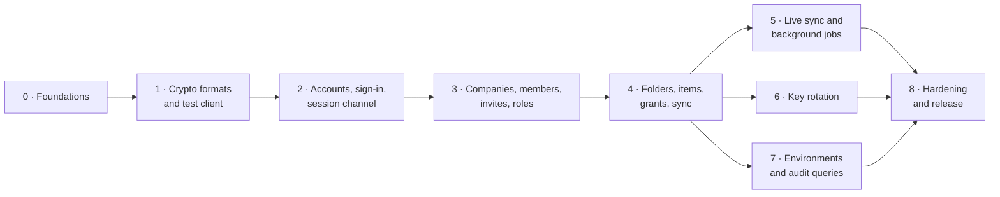

# Back-end implementation plan (MVP)

The MVP back end is built in nine phases. Each phase ends in a working, tested state. The order is chosen so that the riskiest parts come first: the cryptography formats and the encrypted session channel. Every later endpoint depends on them. Requirement IDs refer to [requirements.md](requirements.md); working rules are in [server/CLAUDE.md](../server/CLAUDE.md).

## Phases at a glance

| Phase | Goal | Main requirements | Size | Web/extension work it unblocks |
| --- | --- | --- | --- | --- |
| 0 | Project skeleton, tooling, CI, test database | OPS-03, OPS-06 | S | — |
| 1 | Fixed crypto formats, shared test vectors, Go test client | SEC-01, SES-10, SES-11 | M | `packages/crypto` (TypeScript) can start |
| 2 | Accounts, OPAQUE sign-in, encrypted session channel, MFA | AUTH-*, SES-*, ACT-01/02/10 | L | Sign-up, sign-in and account screens |
| 3 | Companies, invitations, members, roles, groups | ORG-*, ACT-*, USR-*, RBAC-* | L | Company switcher, members, invites, roles |
| 4 | Folders, items, grants, access checks, sync | FLD-*, ITM-*, ACC-* | L | The vault itself; extension autofill |
| 5 | Live sync over SSE, background jobs | SES-06, ACC-04/05 | M | Live updates |
| 6 | Key rotation | ROT-*, SEC-03 | M | Security page |
| 7 | Env-var projects, audit-log queries | ENV-*, AUD-01/03 | M | Env screens, audit screens, CLI |
| 8 | Hardening, packaging, release | OPS-*, SEC-08/10/11, NFR-* | M | Release candidate |

Sizes are relative (S < M < L), not time estimates.

## Principles for every phase

- **Clean architecture.** Each feature is built inside out: domain types and rules first, then use cases with their ports, then the Postgres and HTTP adapters. The layer rules are in [server/CLAUDE.md](../server/CLAUDE.md).
- **Cross-cutting pieces from day one.** Error shape, request IDs, org scoping, permission checks and audit events go into every endpoint in the phase that adds it, never "later".
- **No endpoint without a client test.** Because the server only sees ciphertext, every feature is tested end to end with the Go test client from phase 1, which does the client-side crypto the way the web app will.
- **Contract first.** Each phase adds its endpoints to `spec/openapi.yaml` before the handlers. The spec describes the decrypted payloads; the session envelope is documented once (SES-10).
- **The draft schema can still change.** `00001_init.sql` may be edited until the first tagged release. After that, migrations are additive only (OPS-04).
- **API paths use the organization ID** (`/api/v1/orgs/{orgId}/...`), because slugs can be renamed. The web app resolves the slug in its URL (ACT-04) through `GET /me/orgs`.

---

## Phase 0 · Foundations

**Status:** done on 2026-10-14. Not yet committed; CI has not run on GitHub yet.

**Goal:** an empty but production-shaped service: it builds, lints, tests against real PostgreSQL in CI, and serves health checks.

Already done: Go module, Gin router with `/healthz`, `/readyz`, `/api/v1/meta`, config from env vars, embedded goose migrations, draft schema, Dockerfile, dev Compose file with PostgreSQL.

**Deliverables**
- `Makefile` targets: `dev`, `test`, `lint`, `generate`, `migrate`, `check`.
- `golangci-lint` config; `sqlc` config and the first query file; `oapi-codegen` generating Gin server interfaces from `spec/openapi.yaml`.
- Clean-architecture skeleton: `internal/domain`, `internal/app`, `internal/adapter/{httpapi,postgres,mail,jobs,system}`, with `cmd/server` as the composition root. The existing `internal/httpapi` and `internal/database` packages move into `adapter/httpapi` and `adapter/postgres`.
- `depguard` rules in `golangci-lint` that fail the build if the domain imports app or adapters, or if app imports adapters.
- `adapter/httpapi`: standard error shape, domain-error-to-status mapping, request IDs, body-size limit, cursor pagination helpers.
- `adapter/postgres`: the `TxRunner` that opens transactions and sets `app.org_id` for row-level security.
- Clock and random ports with real adapters (`adapter/system`) and fakes for tests.
- `internal/testdb`: creates a fresh, migrated database per test package from a template database.
- `adapter/jobs`: River queue set up (needed for emails in phase 2).
- `adapter/mail`: SMTP mailer; Mailpit added to the dev Compose file for local email.
- Prometheus `/metrics` on a separate internal port (OPS-06), including database connection-pool metrics; JSON logs without bodies.
- Docker Compose dev stack with PostgreSQL, Mailpit, Prometheus, and Grafana with a provisioned server dashboard (HTTP traffic, errors, latency, database pool, Go runtime). `make up` starts the services; `make dev` runs the server on the host with `go run` (`make dev-watch` adds auto-restart); `make start` runs everything in Docker with the production image and a smoke check.
- CI (GitHub Actions): lint, `go test -race`, `govulncheck`, `sqlc generate` with no diff, Docker build.

**Exit criteria:** `make check` passes locally and in CI; one sample integration test runs against the test database.

---

## Phase 1 · Crypto formats, test vectors and the Go test client

**Goal:** fix every byte format before any data is stored, and prove that the Go and TypeScript libraries agree. This is the highest-risk phase.

**Deliverables**
- `docs/crypto-spec.md`. It defines:
  - OPAQUE configuration: ciphersuite and Argon2id parameters (64 MB, 3 iterations)
  - HKDF labels for the export key → wrapping key and the session-key schedule (SES-04)
  - the wrapped-key format (`version | algorithm | key version | nonce | ciphertext`)
  - the encrypted item format
  - the session envelope and its associated data (SES-02)
- `pkg/vaultcrypto` (Go): wrap/unwrap keys, encrypt/decrypt items, X25519 key wrapping, session encrypt/decrypt with counters. Used by the server (session layer only) and later by the CLI.
- `spec/vectors/*.json`: fixed test vectors for every operation above (SES-11).
- `internal/testclient` (Go): a scripted client that registers, signs in, creates and wraps keys, and encrypts items. Phases 2 to 7 use it for end-to-end tests.

**Spike first (gate for this phase):** confirm that a Go OPAQUE server (candidate `bytemare/opaque`) and the TypeScript client (candidate `@serenity-kit/opaque`) complete a registration and sign-in together with the same ciphersuite. If they do not interoperate, stop and choose a matching pair before going on.

**Exit criteria:** vectors pass in Go; the OPAQUE interop spike passes; the crypto spec is reviewed.

---

## Phase 2 · Accounts, sign-in and the encrypted session channel

**Goal:** a user can create an account, sign in without sending their password, and talk to the API only through the encrypted session channel.

**Requirements:** ACT-01, ACT-02, ACT-10, ACT-11 (account side), ORG-01 (first admin), AUTH-01, AUTH-02, AUTH-07, AUTH-08, SES-01 to SES-05, SES-07 to SES-09, SEC-04, SEC-10.

**Endpoints**
- `GET /setup/status`, `POST /setup`: first-run setup creates the instance admin (ORG-01).
- `POST /auth/register/start|finish`: OPAQUE registration; `finish` also stores the public key, encrypted private key and encrypted user key.
- `POST /auth/login/start|finish`: OPAQUE sign-in; returns the session ID and token. The session key is derived on both sides and never sent.
- `POST /auth/logout`; `GET /me/sessions`; `DELETE /me/sessions/{id}`.
- `POST /auth/mfa/totp/enroll|verify`, recovery codes, MFA step during sign-in.
- `GET /me`, `PATCH /me`, email change with verification, master-password change (new OPAQUE record + re-wrapped keys uploaded by the client).

**Key design points**
- **Session middleware**: looks up the session by token hash, decrypts the envelope, checks the counter window (SES-03) and epoch (SES-04), passes the plaintext body on, and encrypts the response. Handlers never see the envelope.
- Any server node must be able to serve any request, so the session key is stored in the `sessions` row, encrypted with a server key from the environment (SEC-09), and cached in memory. Losing it forces a new sign-in, never a plaintext fallback.
- Sign-in, MFA and registration are rate-limited, and failure messages never reveal whether an email exists (SEC-10).
- An audit writer is added now and records sign-in, sign-out, MFA and session events.

**Exit criteria (all tested with the Go test client):** sign-in works with no password-equivalent stored; a replayed message is rejected; a stale epoch is rejected; a stolen token without the session key is rejected; re-keying keeps working across a 60-minute boundary (simulated with a fake clock).

---

## Phase 3 · Companies, members, invitations, roles and groups

**Goal:** a user can create a company, invite people, give them roles and groups, and switch between companies.

**Requirements:** ORG-01 to ORG-06, ACT-03 to ACT-08, ACT-11, USR-01 to USR-05, USR-10, USR-11, RBAC-01 to RBAC-05, RBAC-07.

**Endpoints**
- `GET /me/orgs` (switcher: company, logo, my role), `POST /orgs`, `GET|PATCH /orgs/{orgId}`.
- Invites: `POST /orgs/{orgId}/invites`, resend, revoke; `GET /me/invites`; `POST /me/invites/{id}/accept|decline`.
- Members: list, change role, suspend, reactivate, remove, `POST /orgs/{orgId}/members/{id}/confirm`.
- `POST /orgs/{orgId}/leave`, `POST /orgs/{orgId}/transfer-ownership`.
- Roles: list, create, update, delete custom roles. Groups: CRUD and membership.

**Key design points**
- **One permission engine**: the permission matrix and scope rules are pure functions in `internal/domain/authz`; an `app/authz` use case loads the member's role and grants and asks the domain `Can(member, permission, scope)`. Every use case calls it; nothing else decides permissions (RBAC-05). It reads roles from the database on each request, so role changes apply immediately (RBAC-07).
- **Row-level security is switched on** for every org-scoped table, with `SET LOCAL app.org_id` in each transaction (ORG-04).
- **Confirming a member is a crypto step:** the confirming admin's client wraps the organization key (and any folder keys from the invite's pre-selected grants) to the new member's public key. The server checks that every required wrapped key is present before marking the member confirmed (USR-05).
- **No-escalation rule** (RBAC-03) and the last-Owner rule (ORG-05) are enforced in services, with tests for each.
- Admins never see a user's other memberships (ACT-08): member queries only join within one organization.

**Exit criteria:** isolation tests prove company A cannot read or change company B; every permission in the matrix (section 6.1) has an allow and a deny test; a user in three companies can list and switch between them.

---

## Phase 4 · Folders, items, grants and sync

**Goal:** the vault works: encrypted folders and items, access grants with expiry, and an efficient sync for clients.

**Requirements:** FLD-01 to FLD-03, FLD-05, ITM-01, ITM-06, ITM-14 to ITM-18 (server side), ACC-01 to ACC-06, SEC-02.

**Endpoints**
- Folders: create, rename/update metadata, move (max depth 5), delete to trash, restore.
- Items: create, update (with revision check → 409 on conflict, NFR-08), move (client re-wraps the item key for the target folder), duplicate, delete to trash, restore, list versions, restore a version.
- Grants: create, update, revoke; `GET /orgs/{orgId}/access?folderId=|itemId=` for the "who has access" panel (ACC-06).
- `GET /orgs/{orgId}/sync?cursor=`: everything the member can see that changed since the cursor (folders, items, wrapped keys, revocations). This is the clients' main read path.
- `GET /me/key-tasks`, `POST /me/key-tasks/{id}/complete`: pending key-wrapping jobs (see below).

**Key design points**
- **Effective access** (ACC-02, ACC-03) is computed in SQL: grants to the member and to their groups, folder scopes expanded with a recursive query over the folder tree when subfolders are included. The highest level wins.
- **Grants carry keys.** Granting folder access needs the folder key wrapped for every member it reaches. The client creating the grant uploads them; the server rejects the grant if any are missing.
- **Key tasks.** When access changes without a key-holder present (a member joins a group, an invite is confirmed later), the server queues a key task. The next online client that holds the key performs the wrapping. This mechanism is reused by rotation in phase 6.
- Folder type rules (FLD-02) are checked against the item's plaintext `type`; everything else in an item is ciphertext.
- Version history keeps the last 20 versions per item (ITM-06); older ones are pruned in the same transaction.

**Exit criteria:** end-to-end tests with the Go test client: an item created by one member is readable by a granted member and unreadable (no keys returned) for others; an expired grant stops sync results; a revoked member gets no keys at their next sync; sync of 10,000 items performs within NFR-02 on the reference setup.

---

## Phase 5 · Live sync and background jobs

**Goal:** changes reach other clients within seconds, and time-based rules run on their own.

**Requirements:** SES-06, ACC-04, ACC-05, NFR-07, USR-03 (expiry), ITM-01 and FLD-05 (trash purge).

**Deliverables**
- `GET /orgs/{orgId}/events`: server-sent events, each encrypted with the session key (SES-06). It tells clients "something changed, sync now"; it never carries item data.
- Fan-out across server nodes with PostgreSQL `LISTEN/NOTIFY`.
- River jobs: expire grants (ACC-04), expire invites (USR-03), purge trash after 30 days, prune old sessions, send queued emails.

**Exit criteria:** a revoke reaches another connected client in under 5 seconds (NFR-07) in a two-node test; every job is idempotent and covered by a test using the fake clock.

---

## Phase 6 · Key rotation

**Goal:** keys rotate on schedule and on access loss, without the server ever seeing them.

**Requirements:** ROT-01 to ROT-07, SEC-03.

**Deliverables**
- A scheduler job that finds keys due for rotation (folder 90 days, organization 12 months, user key pair 12 months, all configurable by Owners) and queues rotation tasks; triggers on member removal and grant revocation.
- Rotation endpoints built on the phase 4 key-task mechanism: an eligible client claims a task, uploads the new wrapped keys and re-wrapped item keys, and the server commits it in one transaction (ROT-03).
- Key versions on every wrapped key (ROT-02); new item keys on next edit after a folder rotation (ROT-04).
- "Rotate now" endpoints (ROT-05); a security overview endpoint with the last rotation of each key and overdue ones (ROT-06); Owner notification when no eligible client completes a task within 24 hours (ROT-01).

**Exit criteria:** a removed member's cached keys cannot read data written after rotation; a 10,000-item folder rotates in under 60 seconds (ROT-07); a half-finished rotation leaves no mixed state.

---

## Phase 7 · Environment-variable projects and audit queries

**Goal:** the server side of developer secrets, and searchable, exportable audit logs.

**Requirements:** ENV-01 to ENV-03, ENV-09, ENV-10, AUD-01, AUD-03.

**Deliverables**
- Projects as folders with `kind = project`; environments as items of type `env`. Grants per environment reuse phase 4 unchanged (ENV-03).
- CLI-friendly endpoints: list projects and environments the user can access (the CLI decrypts names locally to match `pm link --project billing-api`), and a fetch endpoint that records the purpose (`run`, `pull`, `push`) server-side in the audit log (ENV-10).
- Import, export, compare and `.env.example` generation are client-side features (ENV-04 to ENV-07); the server only stores encrypted versions. Per-variable history (ENV-09) is computed on the client from item versions.
- Audit: `GET /orgs/{orgId}/audit-events` with filters by date, actor, action, folder and item, cursor pagination, CSV and JSON export (AUD-03); an endpoint for client-reported events such as reveal and copy, clearly marked as client-reported (section 10.1).

**Exit criteria:** an `env` fetch with purpose `run` appears in the audit log with device and IP; audit filters and exports are tested; no endpoint can update or delete an audit event (AUD-01).

---

## Phase 8 · Hardening and release

**Goal:** a release candidate that a company can install and trust.

**Requirements:** OPS-01, OPS-02, OPS-05, OPS-08, SEC-08, SEC-10, SEC-11, NFR-01, NFR-04, NFR-06, NFR-09.

**Deliverables**
- Multi-arch signed images (amd64, arm64), SBOM, dependency scanning in CI (SEC-11, OPS-01).
- Production Docker Compose file with Caddy and automatic TLS, HSTS and security headers (OPS-02, SEC-08).
- `server backup` and `server restore` commands plus a tested restore drill (OPS-05).
- Air-gapped check: no outbound calls unless enabled (OPS-08).
- Load tests for NFR-01 and NFR-04; zero-downtime rolling upgrade test (NFR-06).
- Internal security review: threat model against section 9.5, rate-limit review, log scan for secrets.
- Install, admin and API docs.

**Exit criteria:** a fresh server reaches a working instance with `docker compose up` in under 30 minutes; all load and upgrade tests pass; the security review has no open high findings.

---

## Decisions needed before or during the build

| Decision | Needed by | Why |
| --- | --- | --- |
| OPAQUE library pair (Go server + TypeScript client) | Phase 1 gate | They must interoperate byte for byte |
| Where session keys live across server nodes | Phase 2 | Recommended: encrypted in the `sessions` row with a server key. Alternative: sticky sessions at the load balancer, which keeps keys in memory only but complicates scaling and restarts |
| Product name and repository location | Before the repository goes public | Go module path, image names, CLI name (placeholder `pm`) |
| Licence | Before the repository goes public | Must be in place before outside contributions |
| Personal vault outside any company | Phase 4 | Changes the folder ownership model |

## What is not in this plan

The web app, browser extension and CLI get their own plans. They can start as soon as the phase they depend on is done: TypeScript crypto after phase 1, sign-in screens after phase 2, the vault and extension autofill after phase 4.
