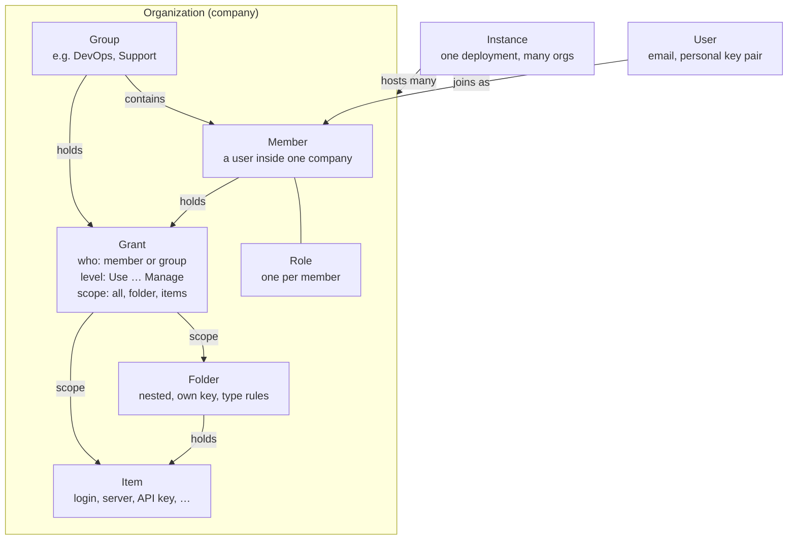
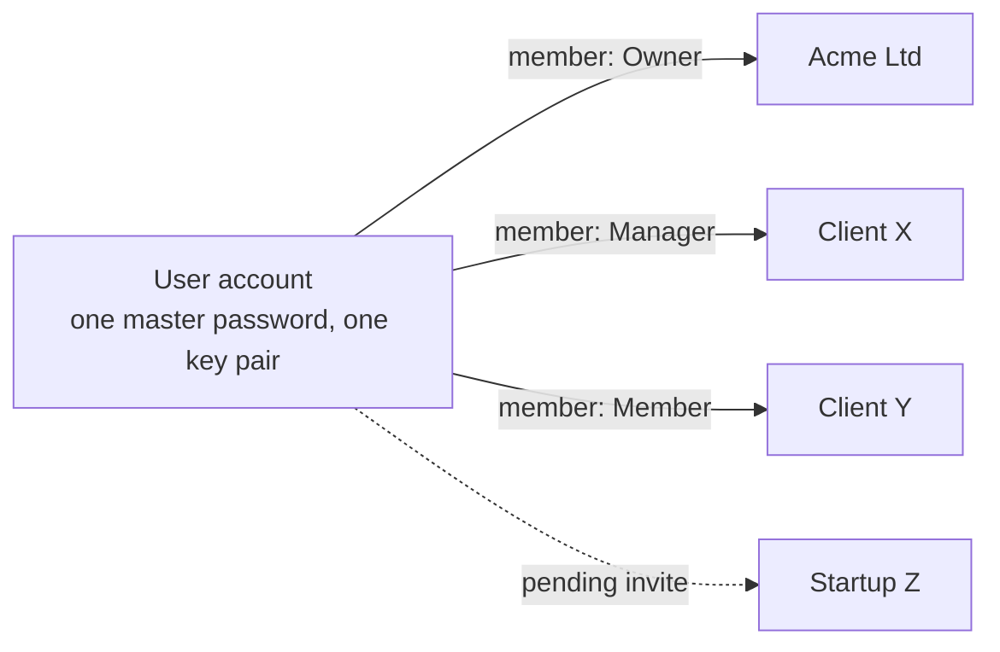
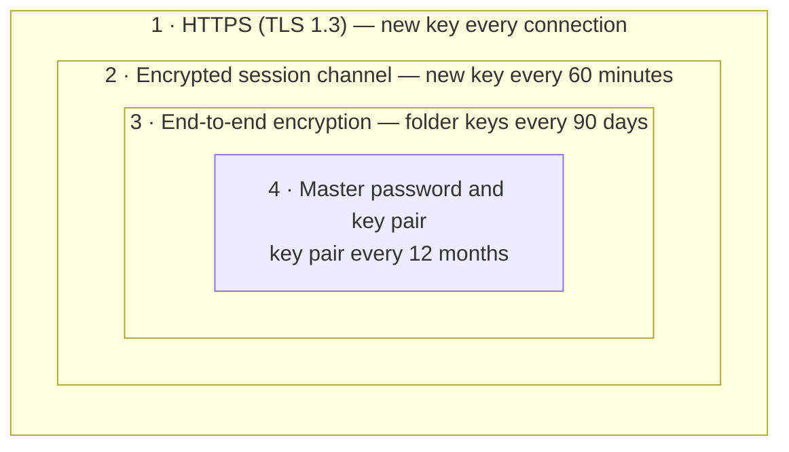
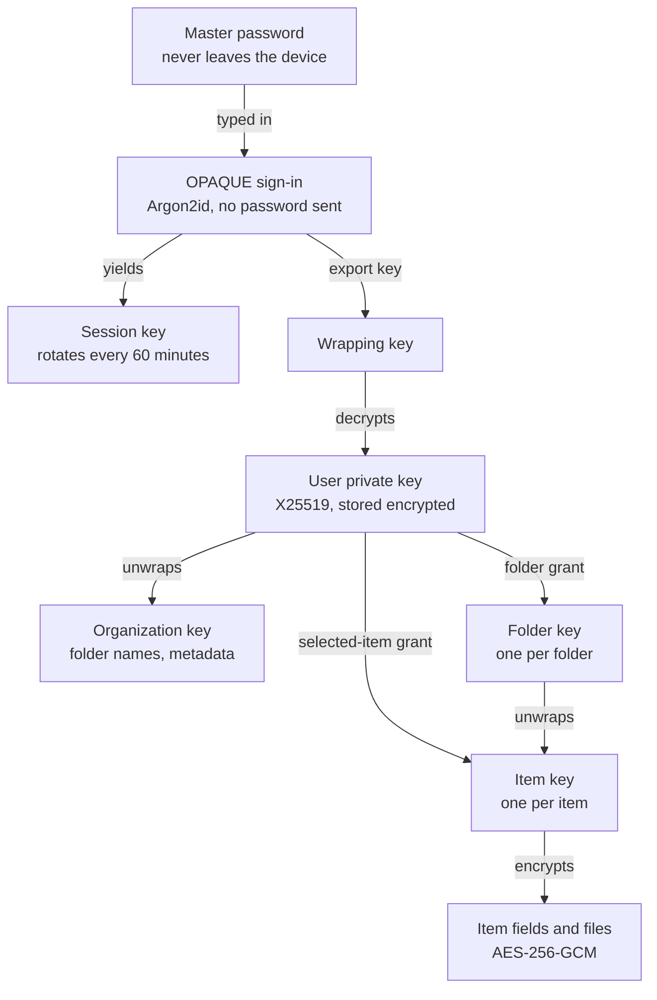

# Open-Source Enterprise Password Manager — Requirements

> This file is the source of truth for the requirements. Edit it directly.

## 1. Overview

We are building a self-hostable, open-source password manager that a company deploys on its own infrastructure to store, organize and share credentials across its teams. Secrets are end-to-end encrypted on the client, so the server and its operators never see plaintext passwords.

**Problem.** Teams keep server, database and SaaS credentials in spreadsheets, chat messages and personal password managers. Nobody can answer "who can see the production VPS root password?", and offboarding an employee means guessing which secrets to rotate.

**Goals**

1. Any company can deploy the product on its own servers in under 30 minutes with Docker.
2. A company admin can organize credentials into folders (for example, a "VPS" folder that only holds server credentials).
3. Access is granular: an admin grants a user or group access to everything, to whole folders, or to selected items.
4. Roles are clear: Owner (super admin), Admin, Manager with a configurable permission set, Member, and Auditor.
5. Every access and change is recorded in a tamper-evident audit log.
6. The server can never read stored secrets (zero-knowledge design).

**Non-goals for the first release**

- A hosted SaaS offering run by us (the product must be self-hostable first; SaaS may come later).
- Consumer and family features such as personal sharing plans or billing.
- Privileged-access management features such as session recording or SSH proxying.

**Guiding principles**

- **Open source, no paywalled security.** MFA, SSO, audit logs and encryption are in the open-source core.
- **Secure by default.** Safe defaults out of the box; weakening a setting needs an explicit admin action and is logged.
- **Least privilege.** Users see nothing until access is granted.
- **Boring to operate.** One container image, PostgreSQL, standard environment variables, documented upgrades and backups.

## 2. Personas and roles

Six roles cover who runs the deployment, who runs a company, and who only uses passwords. Roles control what a person can *administer*; which secrets they can *see* is controlled separately by access grants (section 8).

| Role | Scope | Who it is | What they can do | What they cannot do |
| --- | --- | --- | --- | --- |
| Instance admin | Whole deployment | The IT person who installed the product | Create or disable companies, configure SMTP, storage and instance settings, view instance health | Read any company's secrets |
| Owner (super admin) | One company | Founder, CTO or IT head | Everything in the company: settings, roles, users, folders, grants, recovery, delete the company | Nothing is restricted inside the company |
| Admin | One company | IT or security team | Manage users, groups, folders, grants and policies | Delete the company, remove or demote an Owner |
| Manager | One company, limited to assigned folders or groups | Team lead, DevOps lead | Only the permissions in their role, for example invite users, create folders, grant access to folders they manage | Anything outside their permission set or managed scope |
| Member | One company | Engineer, support agent | See and use only the items granted to them; create items in folders where they have edit rights; keep a private personal folder | Invite users, change access for others |
| Auditor | One company | Compliance or security reviewer | Read audit logs, access reports and password-health reports | See secret values unless also granted access |

A person has one account that exists independently of any company. They can be invited to several companies on the same instance, hold a different role in each, and switch between them, the same way workspaces work in ClickUp, Slack or Notion (section 5.1).

## 3. Core concepts and domain model

Everything a company owns hangs off one Organization; a person sees an item only through a Grant that reaches it. The diagram below shows how the parts relate, and the glossary defines each term used in the rest of this document.



Grants are the only path from people to secrets; a role decides what someone can administer, never what they can see.

| Term | Definition |
| --- | --- |
| Instance | One deployment of the product (one database, one URL). Can host many organizations. |
| Organization | A company. Owns its members, groups, folders, items, roles, policies and audit log. Isolated from every other organization on the instance. |
| User | A person's account on the instance, identified by email. It belongs to no organization: one account, one master password and one key pair serve every company the person joins. Leaving or being removed from a company never deletes the account. |
| Member | The link between one user and one organization, with a role and a status (invited, accepted, confirmed, suspended). A user with three companies has three member records. |
| Group | A named set of members, such as "DevOps" or "Support". Grants to a group apply to all its members. |
| Role | A named set of permissions. System roles (Owner, Admin, Manager, Member, Auditor) plus custom roles. |
| Permission | One administrative action, such as `users.invite` or `folders.create`. |
| Folder | A container for items. Can be nested, can restrict which item types it accepts, and has its own encryption key. |
| Item | One stored secret: a login, server credential, API key, SSH key, note and so on. Belongs to exactly one folder. |
| Grant | "Subject X has access level Y on scope Z". Subject is a member or group; scope is the whole organization, a folder (with or without subfolders) or a single item. |
| Access level | What a grant allows on its scope: Use, View, Edit or Manage (section 8). |
| Audit event | An immutable record of who did what, when, from where. |

## 4. Organizations (companies) and tenancy

One instance hosts one or many organizations, and no data, user list or log ever crosses between them. Users are shared at the instance level, but each organization sees only its own members. A company that self-hosts for itself will usually run a single organization; a managed-service provider or an agency serving several clients can run many.

| ID | Requirement | Phase |
| --- | --- | --- |
| ORG-01 | On first launch, a setup wizard creates the instance admin account and the first organization, with the instance admin as its Owner. | MVP |
| ORG-02 | The instance admin can choose who may create organizations: instance admin only (default), any verified user, or users from allowed email domains. | MVP |
| ORG-03 | An organization has a name, slug, logo, default language and time zone. | MVP |
| ORG-04 | Every database row that belongs to an organization carries its organization ID, and every query is scoped by it; cross-organization access is covered by automated tests. | MVP |
| ORG-05 | An organization must always have at least one Owner. The last Owner cannot leave or be demoted until ownership is transferred. | MVP |
| ORG-06 | Owners can transfer ownership to another confirmed member. | MVP |
| ORG-07 | Organization-wide security policies: minimum master-password strength, MFA required, session timeout, allowed IP ranges, allowed email domains for invites, block personal folders, block export. | v1 |
| ORG-08 | Domain verification via DNS TXT record, so users with a verified domain can be auto-suggested to join. | v1 |
| ORG-09 | Owners can delete an organization after typing its name and passing MFA; data is soft-deleted for 30 days, then purged. | v1 |
| ORG-10 | The instance admin can suspend an organization (members cannot sign in to it) without reading its data. | v1 |
| ORG-11 | Per-organization limits set by the instance admin: maximum members, storage for attachments. | v2 |

## 5. Users, invitations and authentication

Accounts and company memberships are separate. A person signs up once; companies then invite that account, and every accepted invite adds the company to the person's company switcher. Within a company, an invitee becomes a working member only after they accept and an admin confirms them, because confirming is the step that hands them the encryption keys. The membership lifecycle is: **Invited → Accepted → Confirmed → (Suspended) → Removed**.



### 5.1 Accounts and multiple companies

| ID | Requirement | Phase |
| --- | --- | --- |
| ACT-01 | Accounts are instance-level and independent of companies. Anyone can create an account when self-sign-up is enabled (instance setting); otherwise accounts are created through an invite. | MVP |
| ACT-02 | One sign-in unlocks the account for all of its companies; there is no separate password per company. Each company wraps its keys to the user's public key, so joining another company needs no new master password. | MVP |
| ACT-03 | Company switcher at the top of the sidebar lists every company the user is a confirmed member of, with its logo and the user's role; the last company used opens by default. | MVP |
| ACT-04 | Company-scoped URLs (`/o/<company-slug>/...`), so links to a folder or item open in the right company and can be bookmarked. | MVP |
| ACT-05 | Switching company switches everything: folders, items, search, members, settings and audit log show only that company. No screen ever mixes data from two companies. | MVP |
| ACT-06 | A "My invitations" page and a badge on the switcher show pending invites; the user can accept or decline each one. | MVP |
| ACT-07 | A user can leave a company at any time, except as its last Owner (ORG-05). Leaving removes the membership and its keys, never the account. | MVP |
| ACT-08 | Company admins see only their own members. They can never see which other companies a user belongs to. | MVP |
| ACT-09 | Company policies apply when entering that company: if Acme requires MFA, SSO or an allowed IP range, the user must satisfy it to open Acme, while companies without that rule stay reachable. | v1 |
| ACT-10 | Account settings (name, email, master password, MFA, devices, language) are separate from company settings and apply to every company. Changing the email is logged in each company the user belongs to. | MVP |
| ACT-11 | A user can delete their account only after leaving every company, or after transferring ownership where they are the last Owner. | MVP |
| ACT-12 | Optional "All companies" search in the web app and extension, with each result labelled by its company. Off by default in the web app, on in the extension (EXT-17). | v1 |

### 5.2 Invitations

| ID | Requirement | Phase |
| --- | --- | --- |
| USR-01 | An Owner, Admin or a Manager with `users.invite` can invite one or many emails. | MVP |
| USR-02 | The invite pre-selects role, groups and initial grants, so access is ready the moment the user is confirmed. | MVP |
| USR-03 | Invite links are single-use and expire after 7 days (configurable); admins can resend or revoke pending invites. | MVP |
| USR-04 | Invites are sent to an email address. If no account exists, the invitee creates one (name, master password) and lands in the company. If an account exists, the invite appears in that account's invitations (ACT-06) and by email; the user signs in and accepts. An invite can only be accepted by an account whose verified email matches it. | MVP |
| USR-05 | After acceptance, an admin confirms the member, which encrypts the organization and folder keys to the member's public key. Confirmation can be automatic for SSO-verified users (v1). | MVP |
| USR-06 | Bulk invite from a CSV file (email, name, role, groups). | v1 |
| USR-07 | Invites can be limited to allowed email domains. | v1 |

### 5.3 Sign-in and sessions

| ID | Requirement | Phase |
| --- | --- | --- |
| AUTH-01 | Email + master password, signed in with the OPAQUE protocol (SES-01). The master password never leaves the device; the server stores only an OPAQUE record. | MVP |
| AUTH-02 | MFA with TOTP authenticator apps and one-time recovery codes. | MVP |
| AUTH-03 | MFA with WebAuthn security keys and passkeys. | v1 |
| AUTH-04 | Owners can require MFA for all members; non-compliant members are blocked until they enrol. | v1 |
| AUTH-05 | Single sign-on via OpenID Connect (Google Workspace, Microsoft Entra ID, Okta, Keycloak, Authentik). | v1 |
| AUTH-06 | Single sign-on via SAML 2.0. | v2 |
| AUTH-07 | Session controls: idle timeout, absolute timeout, vault lock on idle, list and revoke active sessions and devices. | MVP |
| AUTH-08 | Rate limiting and lockout on failed sign-ins; alerts to the user on sign-in from a new device. | MVP |
| AUTH-09 | New-device approval: optionally require an existing device or an admin to approve a new device. | v2 |

### 5.4 Directory sync and offboarding

| ID | Requirement | Phase |
| --- | --- | --- |
| USR-08 | SCIM 2.0 provisioning: create, update, suspend members and sync groups from an identity provider. | v2 |
| USR-09 | LDAP / Active Directory group sync via a small connector service. | v2 |
| USR-10 | Suspend a member: they lose access immediately, but their grants are kept for reactivation. | MVP |
| USR-11 | Remove a member: grants are deleted, items they created stay in their folders, and the action is logged. | MVP |
| USR-12 | Offboarding report: on removal, list every item the person could view, so admins can rotate those secrets. One click marks them "needs rotation". | v1 |
| USR-13 | A personal folder per member, invisible to admins. On removal, its contents are deleted (or, if policy forbids personal folders, it does not exist). | v1 |

## 6. Roles and permissions

Roles are fixed sets of administrative permissions, and the Manager role is the one that companies tailor. Seeing a secret always needs a grant (section 8); a role alone never shows passwords, except that Owners and Admins can grant themselves access, which is logged.

### 6.1 Permission matrix

✓ = always, — = never, "Opt" = can be switched on in a custom Manager role, "Scoped" = only within the folders and groups the Manager is assigned to manage.

| Permission | Owner | Admin | Manager | Member | Auditor |
| --- | --- | --- | --- | --- | --- |
| `org.settings` — edit name, logo, policies | ✓ | ✓ | — | — | — |
| `org.delete` / transfer ownership | ✓ | — | — | — | — |
| `roles.manage` — create and edit custom roles | ✓ | ✓ | — | — | — |
| `users.invite` | ✓ | ✓ | Opt | — | — |
| `users.confirm` | ✓ | ✓ | Opt | — | — |
| `users.suspend` / `users.remove` | ✓ | ✓ (not Owners) | Opt, Scoped | — | — |
| `users.change_role` | ✓ | ✓ (up to Admin) | — | — | — |
| `groups.manage` | ✓ | ✓ | Opt, Scoped | — | — |
| `folders.create` (top level) | ✓ | ✓ | Opt | — | — |
| `folders.manage` — rename, move, delete, item-type rules | ✓ | ✓ | Opt, Scoped | — | — |
| `grants.manage` — give or revoke access | ✓ | ✓ | Opt, Scoped | — | — |
| `access_requests.approve` | ✓ | ✓ | Opt, Scoped | — | — |
| `audit.read` | ✓ | ✓ | Opt, Scoped | — | ✓ |
| `reports.read` — access and password-health reports | ✓ | ✓ | Opt, Scoped | — | ✓ |
| `recovery.approve` — approve account recovery | ✓ | ✓ | — | — | — |
| `org.export` — export all items | ✓ | Opt | — | — | — |
| Personal folder | ✓ | ✓ | ✓ | ✓ | ✓ |

### 6.2 Rules

| ID | Requirement | Phase |
| --- | --- | --- |
| RBAC-01 | The five system roles exist in every organization and cannot be deleted. | MVP |
| RBAC-02 | Owners and Admins can create custom roles by picking permissions from the matrix and, for Manager-type roles, a managed scope (folders and/or groups). | MVP |
| RBAC-03 | No privilege escalation: nobody can assign a role, permission or access level higher than their own, and nobody can edit their own role. | MVP |
| RBAC-04 | Each member has exactly one role per organization. | MVP |
| RBAC-05 | Permissions are checked on the server for every API call; the UI hides what the user cannot do, but is never the only check. | MVP |
| RBAC-06 | Policy "Owners and Admins see all items": off by default; when on, they get implicit Manage access to every folder. Turning it on is logged and notified to all Owners. | v1 |
| RBAC-07 | Role changes take effect immediately on all the member's sessions. | MVP |

## 7. Folders and credential items

Folders organize items and are the main unit of sharing; a folder can be locked to certain item types, so a "VPS" folder accepts only server credentials. Items are typed records with structured fields, so a server credential always has a host, port and user, not a free-text note.

### 7.1 Folders

| ID | Requirement | Phase |
| --- | --- | --- |
| FLD-01 | Create, rename, move and delete folders; nest folders up to 5 levels (for example `Infrastructure / VPS / Production`). | MVP |
| FLD-02 | Allowed item types per folder: "any" (default) or a list, for example only `Server` in a VPS folder. Creating or moving a disallowed type into it is rejected. | MVP |
| FLD-03 | Folder description, colour and icon, so people know what belongs where. | MVP |
| FLD-04 | Required fields per folder, for example every item in `Production` must have an owner and an expiry date. | v1 |
| FLD-05 | Deleting a folder that holds items needs the items moved first or an explicit "delete all", and lands in trash for 30 days. | MVP |
| FLD-06 | Folder templates: Owners can save a folder setup (types, required fields, grants to groups) and reuse it. | v2 |

### 7.2 Item types

| Type | Fields (all optional except the item name) |
| --- | --- |
| Login | URL(s), username, email, phone, password, TOTP secret, notes |
| Server / VPS | Hostname or IP, port, protocol (SSH, RDP, other), username, password, SSH private key + passphrase, provider, environment, notes |
| Database | Engine, host, port, database name, username, password, connection string, notes |
| API key / token | Service, key ID, secret, scopes, expiry date, notes |
| SSH key | Public key, private key, passphrase, fingerprint (computed), notes |
| Environment variables | Key-value pairs, each marked secret or plain, with an optional comment (section 12) |
| Certificate | Certificate (PEM), private key, chain, expiry date (read from the certificate) |
| Recovery codes | List of one-time codes, each marked used or unused |
| Secure note | Rich text |
| Payment card | Cardholder, number, expiry, CVV, notes |
| Wi-Fi | SSID, password, security type |
| Software licence | Product, licence key, seats, licensed to, expiry date |
| Custom | Fields defined by an organization template |

### 7.3 Item features

| ID | Requirement | Phase |
| --- | --- | --- |
| ITM-01 | Create, view, edit, move, duplicate and delete items; deleted items go to trash for 30 days. | MVP |
| ITM-02 | Custom fields on any item: text, hidden (masked), URL, date, boolean. | MVP |
| ITM-03 | Tags, favourites, and full-text search across names, URLs, usernames and tags (search runs on decrypted data in the client). | MVP |
| ITM-04 | Password generator: length, character sets, passphrase mode; organization policy can set minimums. | MVP |
| ITM-05 | Copy-to-clipboard with automatic clipboard clearing after 30 seconds. | MVP |
| ITM-06 | Version history: the last 20 versions of every item, viewable and restorable by anyone with Edit access. | MVP |
| ITM-07 | Built-in TOTP code generator for items with a TOTP secret. | MVP |
| ITM-08 | Encrypted file attachments, up to 100 MB per file (configurable). | v1 |
| ITM-09 | Expiry and rotation: set an expiry date or a rotation interval; owners are reminded 14 days before. | v1 |
| ITM-10 | Item owner field (a member or group) responsible for keeping it current. | v1 |
| ITM-11 | Import from CSV, Bitwarden, 1Password, KeePass, LastPass and Chrome exports. | v1 |
| ITM-12 | Export of a folder or the whole organization as an encrypted JSON file, only if policy allows; always logged. | v1 |
| ITM-13 | Secure send: share one item with a person outside the company via a one-time, expiring link. | v2 |

### 7.4 Flexible fields: one model for every shape of secret

Credentials come in many shapes, so an item is stored as a type plus an ordered list of fields, and no field except the name is mandatory. A type only suggests which fields to show; users can remove suggested fields and add any others.

| Real-world case | How it is stored | Primary action in the UI and extension |
| --- | --- | --- |
| Website with username + password | Login: username, password | Autofill both |
| Website with email + password | Login: email, password | Autofill both; email fills the username field |
| Site with both username and email | Login: username, email, password | Autofill the field the page asks for |
| Password only (router, Wi-Fi, PIN, disk encryption) | Login or Wi-Fi: password only | Copy password |
| API key only | API key: secret | Copy key; never offered for autofill |
| Key ID + secret pair (AWS, Stripe) | API key: key ID, secret | Copy either; export as env vars |
| Token with expiry (GitHub PAT) | API key: secret, scopes, expiry date | Copy; reminder before expiry |
| One account, several passwords (root + app user) | Server with extra hidden fields, or one item per account | Copy the chosen field |
| Connection string only | Database: connection string | Copy |
| TOTP only (shared 2FA for a team account) | Login: TOTP secret | Copy or autofill the current code |
| SSH access | Server or SSH key: host, user, private key | Copy key; CLI writes it to the SSH agent (v2) |
| A whole app's config | Environment variables | `.env` export, CLI injection (section 12) |

| ID | Requirement | Phase |
| --- | --- | --- |
| ITM-14 | An item is valid with only a name; every other field is optional. | MVP |
| ITM-15 | Each field has a kind (text, hidden, email, URL, phone, TOTP, multiline, date, key-value list) that controls masking, validation and copy behaviour. | MVP |
| ITM-16 | Users can add, remove and reorder fields on any item, including built-in types. | MVP |
| ITM-17 | Each item marks one field as its primary copy target, shown as the one-click copy button in lists. | MVP |
| ITM-18 | Items with a URL and a password (or TOTP) are autofill candidates; all other items are copy-only in the extension. | MVP |

## 8. Access sharing and grants

A grant says **who** (a member or a group) gets **what level** (Use, View, Edit, Manage) on **which scope** (all items, a folder, or selected items), optionally **until when**. A member's access to an item is the highest level among all grants that reach it, directly or through their groups.

### 8.1 Scopes

| Scope | Covers | Example |
| --- | --- | --- |
| All items | Every folder and item in the organization, including ones created later | Grant the Security group View on everything |
| Folder | One folder; a switch decides whether subfolders are included. New items in the folder are covered automatically. | Grant DevOps Edit on `Infrastructure / VPS` |
| Selected items | A hand-picked list of items from any folders | Grant a contractor View on 3 staging servers |
| Tag-based | Every item carrying a tag, including future ones | Grant on-call engineers Use on items tagged `on-call` (v2) |

### 8.2 Access levels

| Level | Can do | Note |
| --- | --- | --- |
| Use | See the item name and URL, autofill and copy the password, but not reveal it on screen | A convenience restriction, not a cryptographic one: the client must decrypt to autofill, so a determined user could extract it. Shown with this warning in the UI. |
| View | Everything in Use, plus reveal every field, attachment and version history |  |
| Edit | Everything in View, plus create, edit, move within scope and delete items |  |
| Manage | Everything in Edit, plus grant and revoke access on this scope, up to Manage | Lets a team lead run their own folder without being an Admin |

### 8.3 Requirements

| ID | Requirement | Phase |
| --- | --- | --- |
| ACC-01 | Grants can target a member or a group, at any scope in 8.1 (except tag-based), at any level in 8.2. | MVP |
| ACC-02 | Effective access = highest level among all grants that cover the item. No "deny" rules in MVP. | MVP |
| ACC-03 | Members see only items they have a grant for; folders appear only if they contain at least one accessible item. | MVP |
| ACC-04 | Grants can carry an expiry date and time; on expiry access is removed automatically and logged. | MVP |
| ACC-05 | Revoking a grant takes effect on the next sync (at most 60 seconds); the UI offers to mark the affected items "needs rotation". | MVP |
| ACC-06 | "Who has access" panel on every folder and item, showing each member, the level, and the grant it comes from (direct or via which group). | MVP |
| ACC-07 | "What can this person access" view per member, exportable as CSV. | v1 |
| ACC-08 | Access requests: members can browse folder names they are allowed to discover and request access with a reason; approvers grant a level and duration in one click. | v1 |
| ACC-09 | Approval policies per folder: grants to this folder need a second Admin's approval (four-eyes). | v2 |
| ACC-10 | Emergency (break-glass) access: a named person can request access to a folder; it is granted automatically after a waiting period unless an Owner rejects it. | v2 |
| ACC-11 | Tag-based grants (8.1). | v2 |

### 8.4 Worked example

Acme creates folders `VPS`, `Databases` and `SaaS`. The DevOps group gets Edit on `VPS` and `Databases`. Support gets Use on `SaaS`. A contractor gets View on two items in `VPS` until 30 November. When the contractor's grant expires, they lose access automatically and the two items are flagged for rotation.

## 9. Security and cryptography

All secrets are encrypted and decrypted only in the client (browser, extension, CLI); the server stores ciphertext and wrapped keys. Folder access is enforced by cryptography, not just by server checks: a member who has no grant never receives the key that opens the folder.

Four layers of encryption sit on top of each other, so a leak in one still leaves the others in place. Every key rotates on a schedule, and Owners can shorten any interval. All of this is in the MVP.

### 9.1 Four layers of protection



An attacker has to get through every layer to reach a password; each layer's key rotates on its own schedule, and the innermost one also needs the master password, which never leaves the device.

### 9.2 Key hierarchy



A folder grant hands the member a copy of that folder's key, wrapped to their public key; without it, the folder's items are unreadable even with a copy of the database.

1. **Master password**: typed on the device and never sent anywhere. Sign-in uses the OPAQUE protocol with Argon2id (64 MB memory, 3 iterations) as its password-stretching step. The server stores only an OPAQUE record, which cannot be used to sign in and resists precomputed attacks.
2. A successful OPAQUE sign-in gives the client two keys: a **session key**, shared with the server, that encrypts the session channel (9.3); and an **export key**, known only to the client, from which HKDF derives the **wrapping key**.
3. Each user has a **personal key pair** (X25519) and a **user key** (AES-256). The private key is stored on the server encrypted under the wrapping key.
4. Each organization has an **organization key** (AES-256) used for metadata every member may see, such as folder names. It is wrapped to each confirmed member's public key.
5. Each folder has its own **folder key**. A folder grant wraps the folder key to the grantee's public key; for a group grant, it is wrapped for each group member.
6. Each item has its own **item key**, wrapped by its folder key. A selected-item grant wraps that item key directly to the grantee.
7. Item fields, attachments and history are encrypted with the item key using AES-256-GCM.

### 9.3 Encrypted session channel

After sign-in, every request and response is encrypted a second time with the session key, inside HTTPS. This defeats HTTPS-inspecting proxies, infrastructure that logs request bodies, and stolen session tokens. The server can read this layer, which is why passwords inside it are still end-to-end encrypted (layer 3).

Every encrypted body uses the same envelope:

```json
{ "sid": "<session id>", "epoch": 7, "ctr": 1042, "nonce": "<base64>", "ct": "<base64 AES-256-GCM ciphertext>" }
```

| ID | Requirement | Phase |
| --- | --- | --- |
| SES-01 | Account creation, sign-in and master-password change use OPAQUE (RFC 9807). No password-equivalent value is ever sent or stored. | MVP |
| SES-02 | Every API request and response body after sign-in is encrypted with AES-256-GCM under the current session key. The associated data binds method, path, session ID, epoch and counter, so a message cannot be moved to another endpoint. | MVP |
| SES-03 | Replay protection: each side numbers its messages; the receiver rejects a counter it has already seen or one older than a sliding window of 1,024 messages. | MVP |
| SES-04 | Re-keying every 60 minutes (Owner-configurable, 15 to 240 minutes): the next key is derived from the current one with HKDF and the epoch number; both sides delete the old key after a 30-second overlap for requests in flight. | MVP |
| SES-05 | A session token alone is useless: requests must also be encrypted with the session key, which lives only in client memory (web: non-extractable WebCrypto key; extension: memory-only session storage; CLI: OS keychain for the session's lifetime). | MVP |
| SES-06 | Live-sync events (server-sent events) are encrypted per event with the same session key. | MVP |
| SES-07 | Only `/healthz`, `/readyz`, `/api/v1/meta` and the OPAQUE handshake accept plaintext; every other endpoint rejects unencrypted bodies. | MVP |
| SES-08 | Session keys are deleted on sign-out, idle timeout and absolute timeout (defaults: 12 hours for web and extension, 30 days for CLI with hourly re-keying). | MVP |
| SES-09 | The server decrypts this layer in memory per request and never logs or stores decrypted bodies. | MVP |
| SES-10 | Official TypeScript and Go client libraries implement the channel; the envelope and key schedule are documented in the OpenAPI spec so others can build clients. | MVP |
| SES-11 | Shared test vectors run in CI against the Go server, the TypeScript client and the Go CLI. | MVP |

### 9.4 Key rotation

Every key has a default rotation trigger and interval, and Owners can shorten the intervals. Rotation re-wraps keys rather than re-encrypting all data, so it stays fast even for large folders.

| Key | Rotates | Owner can set | Who performs it |
| --- | --- | --- | --- |
| HTTPS key (TLS 1.3) | Every connection | No | Browser and server, automatically |
| Session key | Every sign-in and every 60 minutes | 15 to 240 minutes | Client and server, automatically |
| Folder key | When any member or group loses access, and every 90 days | 30 to 365 days | A client that holds the key |
| Item key | When a selected-item grant on it is revoked, and on the next edit after any folder-key rotation | No | A client that holds the key |
| Organization key | When an Owner or Admin leaves, and every 12 months | 3 to 24 months | An Owner's or Admin's client |
| User key pair | Every 12 months, or at once on suspected compromise | 6 to 24 months | The user's own client |
| The real passwords | Flagged when someone who could view them leaves (USR-12), or on expiry (ITM-09) | Per item | A person, or rotation plugins (v2) |

| ID | Requirement | Phase |
| --- | --- | --- |
| ROT-01 | The server cannot rotate keys it cannot read, so it queues due rotations; the next eligible client that comes online performs them in the background. If none does within 24 hours, Owners are notified. | MVP |
| ROT-02 | Every wrapped key carries a version number. Clients can read with older versions until re-wrapping finishes, but always write with the newest. | MVP |
| ROT-03 | A folder-key rotation is committed in one transaction: the new key wrapped for every remaining member, and every item key re-wrapped. | MVP |
| ROT-04 | After a folder-key rotation, each item gets a fresh item key on its next edit, so a removed member's cached keys cannot read new data. | MVP |
| ROT-05 | Owners and Admins can trigger "rotate now" for any folder or the organization key; users can rotate their own key pair. | MVP |
| ROT-06 | Every rotation is written to the audit log. A security page shows the last rotation of each key and any overdue rotations. | MVP |
| ROT-07 | A folder-key rotation of 10,000 items completes in under 60 seconds on the reference setup (section 15). | MVP |

### 9.5 If a key leaks

No single leak exposes everything. The table shows what an attacker gets from each kind of leak.

| What leaks | What the attacker gets |
| --- | --- |
| HTTPS is intercepted or broken | Session-encrypted traffic, with passwords inside still end-to-end encrypted |
| A session token | Nothing usable: requests also need the session key |
| A session key | That session's traffic for at most 60 minutes, and still no password plaintext |
| The server database or a backup | Ciphertext and locked keys only; an offline attack on each master password, slowed by Argon2id |
| One folder key | That folder's items until the next rotation |
| A user's master password | Their access, unless MFA or new-device approval stops the sign-in |
| A device while the vault is unlocked | Everything that user can see. No encryption scheme prevents this; idle lock (SEC-13) and MFA reduce the window. |

Rotating keys does not change a password someone has already seen. Only changing the real password helps, which is why offboarding flags those items (USR-12).

### 9.6 Other security requirements

| ID | Requirement | Phase |
| --- | --- | --- |
| SEC-01 | Use only vetted libraries: WebCrypto and libsodium (or equivalent audited Rust/Go crates). No custom primitives. | MVP |
| SEC-02 | Item names, URLs, usernames, notes and custom fields are all encrypted. The server sees only IDs, folder membership, item type, timestamps and sizes. | MVP |
| SEC-03 | Folder, item, organization and user keys rotate as set out in 9.4. | MVP |
| SEC-04 | Changing the master password re-wraps the user's keys without re-encrypting every item. | MVP |
| SEC-05 | Account recovery (opt-in per organization): each member's user key is also wrapped to an organization recovery key. An Owner or Admin can reset a locked-out member's master password; the member and all Owners are notified and the event is logged. | v1 |
| SEC-06 | Without account recovery, a forgotten master password means the account's data is unrecoverable. The UI says so clearly at sign-up. | MVP |
| SEC-07 | Public-key fingerprints are shown at confirmation, so admins can verify a member's key out of band if they want to. | v1 |
| SEC-08 | Transport: TLS 1.2+ only, HSTS, strict Content-Security-Policy, no third-party scripts in the web app. | MVP |
| SEC-09 | Server-side: database credentials and the server's own secrets loaded from environment or a secrets file; optional encryption of the database at rest is left to the operator and documented. | MVP |
| SEC-10 | Brute-force protection on sign-in, MFA and invite endpoints; generic error messages that do not reveal whether an email exists. | MVP |
| SEC-11 | Signed releases, a software bill of materials (SBOM), dependency scanning in CI, and a published security policy with a disclosure address. | MVP |
| SEC-12 | An independent third-party security audit and penetration test before the v1.0 release; results published. | v1 |
| SEC-13 | Client memory hygiene: lock the vault and drop decrypted data on idle timeout; no secrets in logs, URLs or analytics. | MVP |

## 10. Audit, reporting and compliance

Every security-relevant action, including each time a password is revealed or copied, writes an append-only audit event that nobody, not even an Owner, can edit or delete. Reports built on these events answer the auditor's two questions: who can access what, and who did access what.

### 10.1 Audit log

Each event records: time (UTC), organization, actor (member, API token or system), action, target (item, folder, member, grant), IP address, user agent, device ID and result (success or denied).

Reveal, copy and autofill events are reported by the client, so a modified client could skip them. Server-side events, such as a member downloading a folder's ciphertext and keys, cannot be skipped.

| Category | Events |
| --- | --- |
| Authentication | Sign-in, failed sign-in, MFA enrolled or removed, new device, session revoked, account recovery |
| Members | Invited, accepted, confirmed, role changed, suspended, removed, joined or left group |
| Access | Grant created, changed, expired, revoked; access requested, approved, rejected |
| Items | Created, viewed, revealed, copied, autofilled, edited, moved, deleted, restored, version restored, attachment downloaded |
| Folders | Created, renamed, moved, deleted, type rules changed |
| Organization | Settings or policy changed, export run, ownership transferred, "Admins see all" toggled |

| ID | Requirement | Phase |
| --- | --- | --- |
| AUD-01 | Append-only audit log; no API or UI path to edit or delete events. | MVP |
| AUD-02 | Tamper evidence: each event stores a hash of the previous event (hash chain); a verify command reports any gap or change. | v1 |
| AUD-03 | Filter by date range, actor, action, folder and item; export to CSV and JSON. | MVP |
| AUD-04 | Retention configurable per organization, default 1 year, minimum 90 days. | v1 |
| AUD-05 | Stream events to a SIEM via webhook and syslog (Splunk, Elastic, Datadog, Grafana Loki). | v1 |
| AUD-06 | Alerts by email or webhook for chosen events, for example "an item in `Production` was revealed" or "5 failed sign-ins". | v2 |

### 10.2 Reports

| ID | Requirement | Phase |
| --- | --- | --- |
| RPT-01 | Access report: matrix of members × folders with effective access level. | v1 |
| RPT-02 | Password health: weak, reused and old passwords (computed in the Owner's or Auditor's client, since the server cannot read them). | v1 |
| RPT-03 | Breach check against Have I Been Pwned using k-anonymity, so no full password hash leaves the client. | v1 |
| RPT-04 | Rotation report: items past expiry or flagged "needs rotation" after offboarding. | v1 |
| RPT-05 | Inactive members: no sign-in in the last 90 days. | v1 |
| RPT-06 | Compliance mapping document listing which controls support SOC 2, ISO 27001 and GDPR requirements. | v2 |

### 10.3 Privacy (GDPR)

- A member can export their own personal data and request account deletion.
- Audit events of removed members keep a pseudonymous ID plus the email at time of the event, as the organization's legitimate interest; this is documented for operators.

## 11. Clients and integrations

The web app ships first and does everything; the browser extension and CLI follow in v1 because daily use (autofill) and DevOps use (scripts, CI) depend on them. Every client talks to the same public, versioned REST API, so the community can build more.

| Client | Purpose | Key requirements | Phase |
| --- | --- | --- | --- |
| Web app | Full vault use and all administration | Responsive down to 375 px width; works in the latest two versions of Chrome, Firefox, Safari and Edge | MVP |
| Browser extension | Autofill and save logins while browsing | Chrome, Firefox, Edge, Safari; autofill on matching URL only; detect new and changed passwords; TOTP autofill; unlock with PIN or biometrics | MVP (Chrome, Firefox); v1 (Edge, Safari) |
| CLI | Developers and scripts | `login`, `list`, `get`, `create`, `edit`; JSON output; inject secrets as environment variables into a command (`run -- ./deploy.sh`) | MVP |
| Public REST API | Integrations and automation | OpenAPI 3 spec, versioned (`/api/v1`), pagination, rate limits; returns ciphertext, with official SDKs doing the crypto | v1 |
| Service accounts | Machine access for CI/CD and servers | Non-human members with a token, granted folders like any member, token expiry and IP allowlist, every use logged | v1 |
| Desktop app | Offline access, system-wide autofill | Electron or Tauri wrapper of the web app; offline read-only cache | v2 |
| Mobile apps | iOS and Android | OS autofill providers, biometric unlock, offline read-only cache | v2 |
| Webhooks | Push events to other systems | Signed payloads (HMAC), retries, per-event subscription | v1 |
| Secrets for DevOps | Feed secrets to infrastructure | Kubernetes operator, GitHub Actions action, Terraform provider, Ansible lookup plugin | v2 |
| Automatic rotation | Change real passwords on target systems | Plugins for Linux SSH users, PostgreSQL, MySQL, AWS IAM keys | v2 |

### 11.1 Browser extension: detection and autofill

The extension finds login fields on the page and fills them from matching items, but only when the user has turned autofill on and the page's domain matches the item's URL. One codebase builds for Chrome and Firefox (Manifest V3).

| ID | Requirement | Phase |
| --- | --- | --- |
| EXT-01 | Sign in with the same account as the web app; the vault stays encrypted in the extension and locks on idle or browser close. | MVP |
| EXT-02 | Detect username, email, password, new-password and one-time-code fields using input types, `autocomplete` attributes, names, labels and placeholders, including fields added later by single-page apps. | MVP |
| EXT-03 | Handle multi-step logins where the email and the password appear on separate screens (Google, Microsoft). | MVP |
| EXT-04 | Show an icon inside detected fields; clicking it lists matching items, picking one fills the form. | MVP |
| EXT-05 | Fill via the toolbar popup, the right-click menu, or a keyboard shortcut (default Ctrl/Cmd+Shift+L). | MVP |
| EXT-06 | Autofill on page load: off by default; can be switched on globally or per site. When on, fills only if exactly one item matches. | MVP |
| EXT-07 | URL matching per item: base domain (default), exact host, starts with, exact URL, regular expression, never. | MVP |
| EXT-08 | Phishing guards: never fill on a domain that does not match; never fill in a cross-origin iframe unless the user confirms; never fill a password saved for HTTPS into an HTTP page. | MVP |
| EXT-09 | When the matched item has an email but no username, fill the email into the username field. | MVP |
| EXT-10 | Fill the current TOTP code into a one-time-code field, or copy it to the clipboard after filling the password. | MVP |
| EXT-11 | Offer to save new credentials after a login form is submitted, and to update an item when the password changes; the user picks the folder. | v1 |
| EXT-12 | Password generator inside new-password fields, using the organization's policy. | v1 |
| EXT-13 | Copy-only items (API keys, notes) are searchable in the popup with one-click copy. | MVP |
| EXT-14 | Unlock with a PIN or the device's biometrics after the first sign-in on that device. | v1 |
| EXT-15 | Passkey storage and sign-in. | v2 |
| EXT-16 | An organization policy can disable autofill on page load and set the list of blocked domains. | v1 |
| EXT-17 | Matching items come from every company the user belongs to, each labelled with its company name and logo, because a website login rarely tells you which company it belongs to. Each item still follows its own company's policies. | MVP |

## 12. Developer secrets and environment variables

Developers get an app's environment variables from the vault instead of passing `.env` files around in chat. A **project** is a special folder; each **environment** (development, staging, production) is an item holding key-value pairs. Because both are ordinary folders and items, the grants, encryption, history and audit log from sections 8 to 10 apply unchanged: a developer can have Edit on `development`, Use on `staging` and nothing on `production`.

### 12.1 Developer workflow

```bash
# once per machine
pm login https://vault.acme.com

# once per repository: links the folder to a project, writes .pm.json (no secrets in it)
pm link --org acme --project billing-api --env development

# run the app with variables injected; nothing is written to disk
pm run -- npm start

# or write a local .env file (added to .gitignore automatically)
pm pull

# push local changes after reviewing a diff
pm push --env development
```

### 12.2 Requirements

| ID | Requirement | Phase |
| --- | --- | --- |
| ENV-01 | Create projects with any number of environments; default set is `development`, `staging`, `production`. | MVP |
| ENV-02 | Each variable has a key, a value, a secret flag (masked in UI) and an optional comment. Keys follow `[A-Z_][A-Z0-9_]*` by default. | MVP |
| ENV-03 | Grants per environment, using the access levels in section 8. Use = may inject and pull, but the web app masks values. | MVP |
| ENV-04 | Import by pasting or uploading a `.env`, JSON or YAML file; preview shows added, changed and removed keys before saving. | MVP |
| ENV-05 | Export an environment as `.env`, JSON, YAML, `export KEY=...` shell lines, or a Kubernetes Secret manifest. | MVP |
| ENV-06 | Compare environments side by side, highlighting keys missing in one of them. | MVP |
| ENV-07 | Generate a `.env.example` with keys and comments but no values. | MVP |
| ENV-08 | CLI: `login`, `orgs`, `link`, `run`, `pull`, `push`, `get KEY`, `set KEY=value`, `envs`, `diff`. `run` injects variables into the child process only. `link` stores the company with the project, so a repository always pulls from the right company even when the developer belongs to several. | MVP |
| ENV-09 | Per-variable history: who changed which key, when, with old and new values visible to anyone with View. | MVP |
| ENV-10 | Every `run`, `pull` and `push` is written to the audit log with project, environment, device and IP. | MVP |
| ENV-11 | Inheritance: an environment can be based on another (`staging` based on `shared`), overriding only some keys. | v1 |
| ENV-12 | Personal overrides: a developer can set local values for some keys that only apply to them. | v1 |
| ENV-13 | Service tokens scoped to one environment, read-only by default, for CI/CD and servers. | v1 |
| ENV-14 | Change notifications: developers with access are told when a variable they use changes; `pm run` always fetches the latest values. | v1 |
| ENV-15 | Encrypted offline cache in the CLI with a configurable lifetime (default 24 hours), so `pm run` works without network. | v1 |
| ENV-16 | References: a value can point to another variable or to a field of a vault item, such as `${{ items.prod-db.password }}`, resolved on the client. | v2 |
| ENV-17 | Integrations: GitHub Actions action, GitLab CI, Docker build secrets, Kubernetes operator that syncs an environment into a Secret. | v2 |

## 13. Architecture and tech stack

The back end is a stateless Go service using the Gin framework on PostgreSQL. The web app is React with Tailwind and shadcn/ui. All encryption runs in the clients: one TypeScript crypto package serves the web app and extension, and a Go package serves the CLI. Both must pass the same test vectors.

| Layer | Choice | Why |
| --- | --- | --- |
| API server | Go + Gin, `pgx` driver, `sqlc` for typed queries | Fast, single static binary, easy to scale horizontally |
| Database | PostgreSQL 16 with row-level security on `org_id` as a second guard | One dependency; RLS backs up application checks (ORG-04) |
| Migrations | `goose`, embedded in the binary, run on start | Additive, versioned, with a Down step for development (OPS-04) |
| Background jobs | `river` (Postgres-backed queue) | Grant expiry, emails, key rotation without needing Redis |
| Real-time sync | Server-sent events; Postgres `LISTEN/NOTIFY` to fan out across nodes | Works behind any proxy; no extra broker (NFR-07) |
| Sessions | Random session tokens, stored hashed, revocable; httpOnly cookie for web, bearer token for CLI and extension; every body also encrypted with the session key (9.3) | Instant revocation (AUTH-07) |
| API contract | OpenAPI 3 spec in the repo; Go server stubs and TypeScript client generated from it | One source of truth for all clients |
| Web app | React 19 + TypeScript + Vite, Tailwind CSS, shadcn/ui, TanStack Query, React Router | Accessible components, fast builds |
| Browser extension | TypeScript, Manifest V3, WXT framework, React + shadcn/ui popup | One codebase builds for Chrome and Firefox |
| CLI | Go + Cobra | Single binary for macOS, Linux, Windows |
| Client crypto (TS) | WebCrypto (AES-256-GCM, X25519, HKDF), OPAQUE via @serenity-kit/opaque (candidate, to verify) + `hash-wasm` (Argon2id) | Audited primitives, no custom crypto (SEC-01) |
| Client crypto (Go) | `crypto/aes`, `crypto/ecdh`, `golang.org/x/crypto/argon2`, `hkdf` | Standard library where possible; OPAQUE server and CLI via bytemare/opaque (candidate, to verify) |
| Packaging | Docker image, Docker Compose with Caddy, Helm chart (v1) | Section 14 |

### 13.1 Repository layout

```text
/server        Go API (Gin), clean architecture: cmd/, internal/{domain,app,adapter}/, migrations/
/web           React + Tailwind + shadcn/ui web app
/extension     Chrome and Firefox extension (WXT)
/cli           Go CLI (pm)
/packages/crypto     TypeScript crypto shared by web and extension
/packages/api-client Generated TypeScript API client
/spec          openapi.yaml and crypto test vectors
/deploy        docker-compose.yml, Caddyfile, Helm chart
/docs          Requirements, architecture, security whitepaper
```

### 13.2 Back-end conventions

- Clean architecture: `internal/domain` (entities and pure rules), `internal/app` (use cases and their ports), `internal/adapter` (Gin handlers, Postgres repositories, mail, jobs). Dependencies point inward only, enforced by a linter rule.
- Every request runs inside a transaction that sets `app.org_id`, which the row-level-security policies check.
- Permission checks live in the use cases, never only in handlers (RBAC-05).
- The server never receives plaintext secrets, so it never logs request bodies of item or environment endpoints.

## 14. Self-hosting and deployment

A company should go from a fresh Linux server to a working instance with one `docker compose up` and a setup wizard, in under 30 minutes. Larger companies get a Helm chart and a documented high-availability setup.

### 14.1 Minimum footprint

| Component | Requirement |
| --- | --- |
| Application | One container image (API + web app), stateless, horizontally scalable |
| Database | PostgreSQL 15 or newer (the only required dependency) |
| File storage | Local disk by default; any S3-compatible store (AWS S3, MinIO, Cloudflare R2) for attachments |
| Email | Any SMTP server, for invites and alerts |
| Cache / queue | Optional Redis or Valkey for multi-node deployments (rate limits, sessions, background jobs) |
| Small setup | Up to 100 users on 2 vCPU, 2 GB RAM |

### 14.2 Requirements

| ID | Requirement | Phase |
| --- | --- | --- |
| OPS-01 | Official images for amd64 and arm64, published to a public registry, signed. | MVP |
| OPS-02 | Docker Compose file with the app, PostgreSQL and a reverse proxy with automatic Let's Encrypt TLS (Caddy). | MVP |
| OPS-03 | All configuration through environment variables or a single config file; every option documented with its default. | MVP |
| OPS-04 | Database migrations run automatically on start, are additive, include a Down step for development rollbacks, and are tested from every previous minor version. Destructive changes ship as expand, migrate data, then contract, across releases. | MVP |
| OPS-05 | Backup and restore commands for database and attachments, with a documented restore drill. Backups contain only ciphertext. | MVP |
| OPS-06 | Health and readiness endpoints; Prometheus metrics (request rates, latency, errors, job queue); structured JSON logs without secrets. | MVP |
| OPS-07 | Helm chart for Kubernetes with multiple replicas, external PostgreSQL and S3. | v1 |
| OPS-08 | Works fully offline (air-gapped): no calls home, no external fonts or CDNs; breach check and update check can be switched off. | MVP |
| OPS-09 | Semantic versioning, changelog per release, at least 6 months of security fixes for each minor release. | v1 |
| OPS-10 | Optional anonymous usage telemetry, off by default. | v2 |

### 14.3 Open-source project setup

- Public Git repository with licence, `CONTRIBUTING.md`, code of conduct, `SECURITY.md` and issue templates.
- CI runs unit, integration and end-to-end tests, linting, dependency and container scanning on every pull request.
- Documentation site: install guides (Compose, Kubernetes, bare metal), admin guide, user guide, API reference, security whitepaper describing section 9.

## 15. Non-functional requirements

These targets are measured on the reference setup of 4 vCPU, 8 GB RAM and a local PostgreSQL, and are checked by automated load tests before each release.

| Area | ID | Target |
| --- | --- | --- |
| Performance | NFR-01 | API responses under 200 ms at the 95th percentile for normal calls. |
| Performance | NFR-02 | A vault of 10,000 items syncs and is searchable in under 3 s on a mid-range laptop. |
| Performance | NFR-03 | Unlock (key derivation + decrypting keys) under 1.5 s on a mid-range laptop. |
| Scale | NFR-04 | One instance supports 10,000 users, 1,000,000 items and 500 organizations. |
| Availability | NFR-05 | High-availability setup (2+ app nodes, replicated PostgreSQL) reaches 99.9% monthly uptime; no single point of failure in the app tier. |
| Availability | NFR-06 | Rolling upgrades with no downtime between consecutive minor versions. |
| Sync | NFR-07 | Changes reach other online clients within 5 s (WebSocket or server-sent events, with polling fallback). |
| Reliability | NFR-08 | No item update is lost under concurrent edits: conflicting saves are detected (version check) and the user chooses which to keep. |
| Recovery | NFR-09 | Documented restore from backup within 1 hour for 1,000,000 items. |
| Accessibility | NFR-10 | Web app meets WCAG 2.2 level AA; full keyboard navigation. |
| Localization | NFR-11 | All UI text in translation files; English at launch, community translations through a translation platform; right-to-left layout supported. |
| Usability | NFR-12 | A new member can find and copy a granted password within 2 minutes of first sign-in, without training. |
| Maintainability | NFR-13 | 80% unit-test coverage of the crypto and permission modules; every permission rule has an automated test. |
| Compatibility | NFR-14 | Public API keeps backward compatibility within a major version; deprecations announced one minor release ahead. |

## 16. Release phases

The MVP is the smallest product one team can adopt for real: organizations, roles, folders, grants, encryption and an audit log in a web app. The Chrome and Firefox extension and the CLI for environment variables are in the MVP, because daily use depends on them. SSO, the public API and service tokens move to v1.0, which is not released until an independent security audit passes. Dates are set once the team size is known.

| Phase 1 · MVP — a team can store and share | Phase 2 · v1.0 — ready for daily company use | Phase 3 · v2 — enterprise scale and DevOps |
| --- | --- | --- |
| Setup wizard, company switcher | Env inheritance, CI tokens | SAML, SCIM, LDAP sync |
| Invites and custom roles | REST API, service accounts | Mobile and desktop apps |
| Groups | OIDC single sign-on | Tag-based grants |
| Folders with type rules | Attachments, import, export | Four-eyes approval |
| 10 item types, history, TOTP | Access requests | Break-glass access |
| Grants: all, folder, items | Offboarding rotation list | Secure send to outsiders |
| Expiring grants | Account recovery | DevOps integrations |
| E2EE, OPAQUE, key rotation | Passkeys and enforced MFA | Automatic rotation |
| Audit log, CSV export | Health reports, breach check | Event alerts |
| Web app, Docker Compose | SIEM streaming, webhooks | |
| Chrome + Firefox autofill | Helm chart | |
| Env vars and the pm CLI | | |

Gates: MVP → v1.0 after a pilot company uses it daily for 4 weeks; v1.0 ships only after a third-party security audit is passed and published.

Every requirement in sections 4 to 15 carries its phase, so each phase's backlog is the list of IDs tagged with it.

## 17. Open questions and decisions needed

Nine decisions shape the build. The tech stack, encryption model and multi-company model are decided; the licence should be settled before the first public release.

- [x] **Tech stack.** Decided: Go + Gin + PostgreSQL back end, React + Tailwind + shadcn/ui web app, WXT extension for Chrome and Firefox, Go CLI (section 13).
- [x] **Encryption model.** Decided: four layers, per-folder keys, OPAQUE sign-in, an encrypted session channel and scheduled key rotation, all in the MVP (section 9).
- [ ] **Licence.** AGPL-3.0 (forks that run it as a service must publish changes; used by Bitwarden server and Passbolt) or Apache-2.0 / MIT (easier corporate adoption, but a competitor can sell a closed fork). *Recommendation: AGPL-3.0.*
- [ ] **Product name** and domain, needed for the repository, images, docs and the CLI command (placeholder: `pm`).
- [x] **One or many organizations per instance.** Decided: many. Accounts are independent of companies, one account can join many companies and switch between them (sections 4 and 5.1).
- [ ] **Personal vault outside any company.** Today each membership has its own personal folder (USR-13), which disappears when the user leaves that company. Should an account also have a private vault that belongs to no company, like Bitwarden's individual vault? *Recommendation: yes in v1, with a company policy that can block moving company items into it.*
- [ ] **Deny rules.** Is "grant DevOps the `Infrastructure` folder except `Infrastructure / Payroll-DB`" needed? MVP assumes no; nested folders with separate grants cover most cases.
- [ ] **Account recovery default.** Off (strongest privacy; forgotten password = lost data) or on (an Admin can reset). *Recommendation: off by default, one switch for Owners to enable.*
- [ ] **Hosted SaaS later.** If a paid hosted version is planned, the licence and any contributor licence agreement should be decided now.
