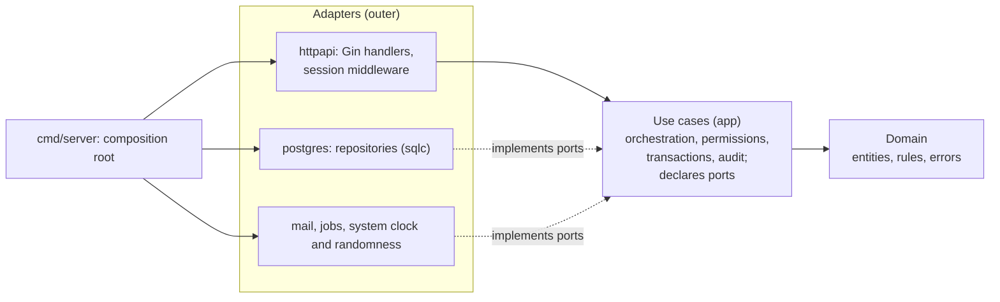

# Back-end rules (Go + Gin + PostgreSQL)

Applies on top of the root [CLAUDE.md](../CLAUDE.md).

## Clean architecture

Dependencies point inward only: adapters depend on use cases, use cases depend on the domain, and the domain depends on nothing in this project. Business rules never import Gin, pgx, sqlc, SMTP or River.



## Layout
```text
cmd/server/                     composition root: config, build adapters, inject into use cases, start
internal/domain/<feature>/      entities, value objects, domain errors, pure rules
                                (e.g. grant.EffectiveLevel, authz permission matrix, folder depth rule)
internal/app/<feature>/         use cases: one exported method per operation, input/output types,
                                and the ports (interfaces) the feature needs
internal/adapter/httpapi/       Gin router, middleware, error mapping, metrics, session-channel middleware
  apigen/                       generated from spec/openapi.yaml (make generate); never edit
  <feature>.go                  handlers: map HTTP <-> use-case input/output, errors -> status
internal/adapter/postgres/      pool, migrations, TxRunner (sets app.org_id for row-level security)
  sqlcgen/                      generated from queries/ (make generate); never edit
  <feature>/                    repositories implementing the app ports with sqlc
internal/adapter/jobs/          River queue and workers; Outbox implements app/notify.Outbox
internal/adapter/mail/          SMTP sender
internal/adapter/system/        real clock and crypto/rand randomness
internal/platform/              config (env vars, *_FILE secrets) and logging
internal/testdb/                fresh migrated PostgreSQL database per test
pkg/vaultcrypto/                crypto formats shared with the CLI (no project imports)
queries/                        sqlc .sql files, one per feature
migrations/                     goose migrations, embedded in the binary
```
Features: account, auth, session, org, member, invite, role, group, folder, item, grant, keytask, rotation, env, audit.

## Layer rules
- **Domain:** plain Go types and functions. No I/O, no `context.Context`, no imports from `app` or `adapter`. Unit-tested without fakes.
- **Use cases (app):** orchestrate one operation: load through ports, apply domain rules, check permissions (RBAC-05), write audit events, commit. Ports are small interfaces declared here, next to the code that uses them. Input and output are app types, never HTTP or sqlc types.
- **HTTP adapter:** validate input, call exactly one use case, map the result or domain error to HTTP. No SQL, no business rules, no permission logic.
- **Postgres adapter:** implements repository ports with sqlc. Maps sqlc rows to domain types; rows never leave the adapter. Every org-scoped query takes `org_id`.
- **Transactions:** use cases run work through a `TxRunner` port, `Run(ctx, orgID, func(ctx context.Context, repos Repos) error)`. The Postgres adapter opens the transaction, sets `SET LOCAL app.org_id` for row-level security, and hands repositories bound to that transaction.
- **Composition root:** only `cmd/server` knows concrete types and wires them together. No global mutable state, no `init()` side effects.
- Keep it pragmatic: a port exists only at a real boundary (database, mail, queue, clock, randomness, crypto). No generic repositories, no interfaces with a single caller "just in case".
- The dependency rule is enforced by `golangci-lint` `depguard`: `internal/domain` may not import `internal/app` or `internal/adapter`, and `internal/app` may not import `internal/adapter`.

## Go style
- `gofmt` + `goimports`; code must pass `golangci-lint`.
- `context.Context` is the first parameter of anything that does I/O; respect cancellation; set timeouts on DB and external calls.
- Wrap errors with `fmt.Errorf("...: %w", err)`. Domain errors are typed or sentinel values checked with `errors.Is` / `errors.As`. Never ignore an error; never `panic` for control flow.
- JSON struct tags in camelCase; request DTOs are separate from DB rows.
- Durations, limits and sizes are named constants.

## Validation (at the handler boundary)
- Limit request body size (1 MB default; attachments use their own endpoint and limit).
- Reject unknown JSON fields.
- Parse UUID path params and enums explicitly; reject anything invalid with 400 before calling the use case.

## HTTP errors
| Status | When |
| --- | --- |
| 400 | Validation failed (`code`: `invalid_input`, with field details) |
| 401 | Not signed in, expired session, or bad session-channel envelope |
| 403 | Signed in, but the role or grant does not allow the action |
| 404 | Not found, **or** belongs to another organization (never reveal it exists) |
| 409 | Revision conflict on concurrent edits (NFR-08), duplicate name |
| 413 | Request body over the limit (1 MB by default) |
| 429 | Rate limited |
| 500 | Unexpected; generic message to the client, details in logs with the request ID |

## Database
- Queries live in `queries/*.sql` and are generated with sqlc. No SQL built from strings.
- Use cases open transactions through the `TxRunner` port; the Postgres adapter sets `SET LOCAL app.org_id` in each one so row-level security applies.
- Migrations: `migrations/NNNNN_name.sql`, goose Up and Down sections, additive only (root rules section 6).
- Add an index for every new query's filter and sort columns.
- Lists use keyset (cursor) pagination.

## Security
- The session-channel middleware decrypts requests and encrypts responses (SES-02). Handlers never touch the envelope.
- Never log request or response bodies. Use `slog` with structured fields; IDs, not emails.
- Rate-limit sign-in, MFA, invite and account-creation endpoints (AUTH-08).
- Time comes from the injected clock; randomness from `crypto/rand` via the injected source.
- Job arguments are stored as plain JSON in the queue table. Never put secrets (invite tokens, reset links) in them; a job that needs one generates it when it runs.

## Metrics
- Every new feature adds the metrics an operator needs to see it working: counters for outcomes, histograms for latency. Names start with `pm_`, use snake_case, and counters end in `_total`.
- Labels have small, fixed value sets: route templates, status codes, job kinds. Never IDs, emails, org slugs or raw paths.
- When a metric matters to operators, add a panel to `deploy/observability/grafana/dashboards/pm-server.json` in the same change.

## Tests
- Table-driven tests. Domain rules get plain unit tests. Use cases are tested with in-memory fakes of their ports (repositories, clock, random, mailer).
- Repository and row-level-security tests run against real PostgreSQL (`deploy/docker-compose.dev.yml`), never mocks.
- Every org-scoped use case has a test proving organization A cannot read or change organization B's data.

## Checks to run
```bash
make check            # lint (incl. layer rules), vet, all tests against PostgreSQL and Mailpit
make generate-check   # generated sqlc and OpenAPI code is up to date
```
`make help` lists everything. Day to day: `make dev` (or `make dev-watch` for auto-restart) runs the server on the host with `go run` against the Docker services from `make up`. Before handing work back, `make start` builds the production image, runs the whole stack in Docker and smoke-checks it.
